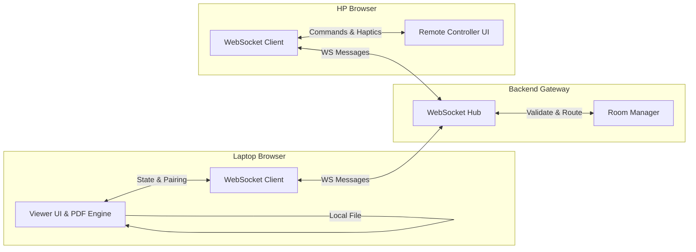
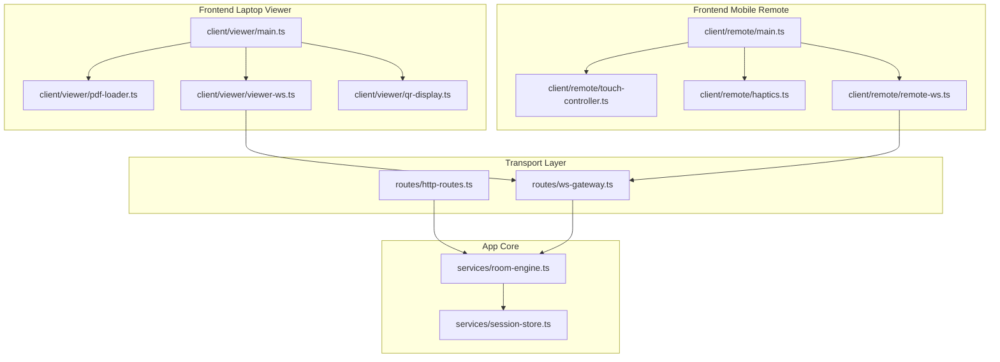

# Architecture Specification: Presentation Remote

## 1. Tech Stack
- **Runtime & Server**: Node.js / Bun (Fast HTTP + native WebSocket engine).
- **Backend Framework**: Hono / Fastify (minimal overhead, zero bloat).
- **Realtime Layer**: Native WebSocket (`ws` protocol) dengan heartbeat ping/pong.
- **Frontend Framework**: Vanilla TS + Tailwind CSS / Lightweight Preact (tanpa heavy SPA framework, fast initial load).
- **Document Rendering**: Client-side Multi-Engine (PDF.js untuk PDF lokal, PPTX viewer parser, serta iframe sandbox controller untuk Google Slides / Canva link publik). File lokal tidak diupload ke server.
- **Persistence / State**: In-memory state (Map dengan TTL auto-evict). Opsional: Redis jika scale horizontal multiserver.

## 2. In-Memory State Schema

```typescript
interface RoomSession {
  roomId: string;             // 6 alphanumeric chars (e.g. "K7M2P9")
  viewerSocketId: string;     // Connection ID browser laptop
  remoteSocketIds: Set<string>; // Connection ID mobile remote (HP)
  totalSlides: number;
  currentSlide: number;
  isBlackout: boolean;
  createdAt: number;          // Epoch timestamp
  expiresAt: number;          // Epoch timestamp (TTL 2 jam)
}
```

## 3. Data Flow



## 4. API & WebSocket Contract

### HTTP Endpoints
- `POST /api/rooms`
  - Response: `{ "roomId": "ABC123", "joinUrl": "https://host/r/ABC123", "token": "jwt-or-opaque" }`
- `GET /api/rooms/:roomId/status`
  - Response: `{ "active": true, "slideCount": 24 }`

### WebSocket Events (Protocol JSON)

#### Client -> Server
```json
// HP kirim perintah
{
  "type": "NAVIGATE",
  "roomId": "ABC123",
  "payload": { "direction": "NEXT" | "PREV" | "FIRST" | "LAST" | "GOTO", "targetSlide": 5 }
}

// HP kirim blackout toggle
{
  "type": "SET_BLACKOUT",
  "roomId": "ABC123",
  "payload": { "state": true }
}

// Laptop update total slide
{
  "type": "SYNC_META",
  "roomId": "ABC123",
  "payload": { "totalSlides": 30, "currentSlide": 1 }
}
```

#### Server -> Client (Broadcast ke Room)
```json
{
  "type": "STATE_UPDATED",
  "payload": {
    "currentSlide": 6,
    "totalSlides": 30,
    "isBlackout": false,
    "connectedRemotes": 1
  }
}
```

## 5. Module Dependency Map & Architecture Graph


