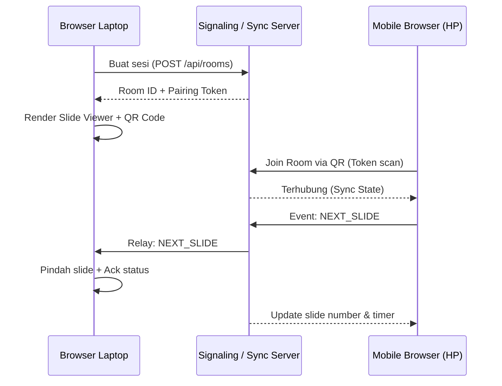

# PRD: Nongle - Zero-Dongle Presentation Remote

## 1. Problem Statement
Presenter butuh kendali slide jarak jauh tanpa membawa hardware clicker fisik dan tanpa hak akses instalasi aplikasi/driver di laptop venue atau HP pribadi.

## 2. Target User
- Speaker konferensi, dosen, mahasiswa, profesional bisnis.
- Pengguna laptop kantor dengan policy restricted (larangan instalasi file `.exe`/`.dmg`).
- Pengguna HP Android/iOS dengan browser modern (Chrome, Safari).

## 3. Core Architecture Decision
Web browser kedua sisi (Laptop & HP). 
- Laptop: Buka URL web viewer (Chrome/Firefox/Edge/Safari), muat file presentasi (PDF/Markdown/Images), generate QR Code room session.
- HP: Scan QR Code via kamera bawaan, buka URL remote mobile di mobile browser.
- Sinkronisasi: WebSocket / WebRTC DataChannel via Signaling Server (low latency < 50ms).

## 4. Core User Flow

## 5. MVP Scope
### In Scope (MVP)
- **Room Management**: Generate 6-digit room code & QR code unik, TTL 2 jam, auto-disconnect on idle.
  - Render deck PDF lokal (PDF.js), file PPTX (via client-side parser / converted slides), serta Embed URL (Google Slides / Canva / Web slides).
  - Fullscreen mode (Shortcut 'F').
  - Keyboard listener fallback (Panah kanan/kiri/spasi).
- **Mobile Remote (HP)**:
  - Mode Switcher: Clicker, Touchpad, dan Gyro Air Pointer.
  - Mode Clicker: Tombol Next & Previous besar (haptic feedback) + gestur swipe.
  - Mode Touchpad: Area trackpad sentuh untuk kontrol laser pointer layar laptop.
  - Mode Gyro Air Pointer: Laser pointer mengikuti gerakan kemiringan HP di udara via DeviceOrientation API.
  - Slide counter (`Current / Total`).
  - Elapsed presentation timer.
  - Black screen toggle ('B').

### Out of Scope (MVP)
- Virtual laser pointer via HP gyroscope (fase 2).
- Presenter speaker notes sync (fase 2).
- Konversi server-side kompleks (semua render di browser client untuk privasi & zero install).
